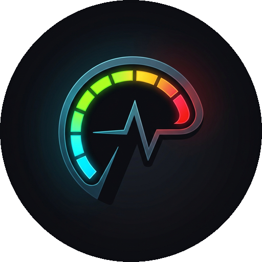

# PulseShift Android App

<p align="center">
  
</p>

Companion app for the PulseShift ESP32 shift-light controller (see the
[firmware repository](https://github.com/iamaritrasaha/PulseShift) and its
`docs/BLE-PROTOCOL.md` for the wire contract).

## Build & install (first time)

1. Install **Android Studio** (or just its SDK) and open this folder
   (`D:\Development\PulseShift\android`) as a project.
2. Let Gradle sync (JDK 23 is preconfigured via `gradle.properties`).
3. Build and install on a phone with Android 8.0+ (BLE required):
   ```powershell
   .\gradlew.bat :app:assembleDebug
   adb install -r app\build\outputs\apk\debug\app-debug.apk
   ```
   The debug APK is also prebuilt at
   `app\build\outputs\apk\debug\app-debug.apk` after any build.
4. On the phone: allow **Nearby devices** permission (Android 12+ asks for
   `BLUETOOTH_SCAN`/`BLUETOOTH_CONNECT`) and turn Bluetooth on.

## First connection

1. Flash the ESP32 with the firmware (Arduino IDE: board "ESP32 Dev Module",
   partition "Default 4MB with spiffs", upload from the firmware repo).
2. Power the ESP32. It advertises as **PulseShift**.
3. In the app, open **Devices** from the dashboard/device connection action, then scan and connect.
4. **Owner enrollment (once per device):** press the physical **BOOT** button
   on the ESP32 (a 60-second cyan pulse opens the commissioning window), then
   in the app choose *Enroll as Owner* and confirm. The secret is generated on
   the phone, stored in the Android KeyStore and proven by challenge-response
   on every later connection.
5. The Dashboard now shows live estimated RPM (labeled **UNVERIFIED** until a
   firmware-driven calibration is completed from the RPM tab).

## Terminal

Open **Terminal** from the app's diagnostics or device controls for a command console over the authenticated BLE
protocol (`HELP` lists everything). Destructive commands (CONFIG RESET,
RESTART, CLEAR DIAGNOSTICS) ask for confirmation; USB-only operations
(STREAM, CLEAR YES) are refused with an explanation instead of faked.

## Compatibility and configuration

The Android app and ESP32 firmware are versioned separately. Updating the Android APK does **not** update or reflash the ESP32. Ordinary app UI changes, phone-side presets and controls for firmware-supported capabilities must continue to work with the installed device firmware.

- **Device-side defaults:** LEDs activate at 1000, 2000, 3000, 4000, 5000 and 6000 RPM; warning at 6500 RPM. These thresholds do not cap the displayed live RPM.
- **Shipped phone presets:** default to **100% brightness (255/255)** in the pending Android repair release; custom presets must preserve individually saved brightness.
- **Current RPM conversion:** provisional CAN ID `0x301`, byte 0, multiplier 40.0. Never assume firmware calibration is verified because the UI shows RPM. Verified effect 4 requires a calibration record; provisional effect 5 is the normal unverified preview.
- **Two different saves:** saving a preset writes phone-side storage; applying a preset writes the active ESP32 configuration; `CONFIG SAVE` persists that configuration to ESP32 NVS. Only an acknowledged and persisted save should be displayed as saved permanently.
- **Authorization:** RPM telemetry is not proof of authorization for configuration, historical log or capture access. Connect and enroll/authenticate through Devices before privileged commands. `HELP` in Terminal lists the commands understood by the installed app; some require newer firmware capabilities.

**Upgrade safety:** the current firmware does not have a demonstrated, supported phone-triggered OTA update path. Do not use unverified update files or erase/repartition the ESP32 to install a UI change. Before any firmware update, export valued CAN recordings and retain a recoverable working build. For firmware code, pin compatibility against [the BLE protocol contract](https://github.com/iamaritrasaha/PulseShift/blob/main/docs/BLE-PROTOCOL.md).

## Verification status

The Android repair work is tracked in [PR #1](https://github.com/iamaritrasaha/PulseShift-Android/pull/1). Unit tests and an emulator build were reported for the proposed changes, but real phone/ESP32 regression tests are required before considering BLE reconnect, configuration persistence and all terminal operations verified. Keep the previous working APK and its saved data until the replacement is confirmed on hardware.

